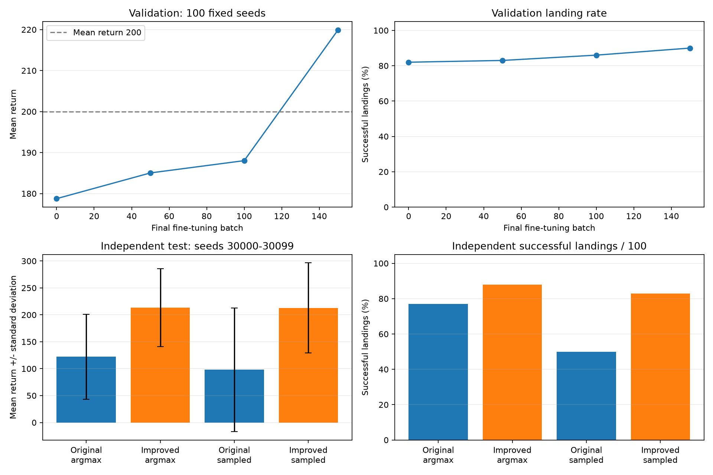

# LunarLander：REINFORCE 改进方案与实测结果

## 结果

继续使用自写 REINFORCE 策略梯度，没有使用 PPO。最终在 **100 个未参与训练或选模型的种子 `30000–30099`** 上测试，新旧模型使用相同环境和动作选择方式。

| 模型与执行方式 | 平均奖励 ± 标准差 | 成功着陆 | 得分 ≥ 200 | 超时 |
| --- | ---: | ---: | ---: | ---: |
| 原版：最大概率动作 | 122.1 ± 79.1 | 77/100 | 9/100 | 16/100 |
| 改进：最大概率动作 | 213.5 ± 72.2 | 88/100 | 82/100 | 4/100 |
| 原版：随机采样 | 98.1 ± 114.9 | 50/100 | 26/100 | 5/100 |
| 改进：随机采样 | 212.9 ± 83.5 | 83/100 | 82/100 | 4/100 |

最大概率动作模式：平均奖励从 **122.1 提高到 213.5**，着陆从 **77/100 提高到 88/100**。随机采样模式：平均奖励从 **98.1 提高到 212.9**，着陆从 **50/100 提高到 83/100**。仍存在失败和超时，不能保证每局成功。



这是一条训练种子为 53 的模型结果；100 个测试种子用于评估不同游戏初始条件。新模型使用了更大网络和更多训练，结果反映整组改进，不是单个参数的独立作用。

## 改进方案

1. **扩大网络。** 策略为 `8 → 128 → 128 → 64 → 4`，回报预测为独立的 `8 → 128 → 128 → 64 → 1`，共 **52,165 个参数**。回报预测损失不会改变策略网络参数。
2. **给 REINFORCE 加状态回报 baseline。** 仍然倒序计算整局 Monte Carlo 折扣回报，不使用 PPO 或一步自举回报；用实际回报减去预测回报，降低策略更新噪声。
3. **重视较晚的着陆奖励。** `gamma = 0.999`，500 步后奖励的权重约 60.6%，原来 `0.99` 时约 0.66%。
4. **更充分地训练回报预测。** 每组 5 局数据，策略只更新 **1 次**，独立回报网络拟合 **20 次**。重复的回报回归不会重复更新策略。
5. **稳定续训。** Adam 的策略学习率 `0.0001`、回报学习率 `0.001`，熵奖励 `0.001`，梯度最大范数 `1`。从已有较好模型继续，分离共享特征时复制权重，已检查迁移前后预测一致。
6. **减少后期无效探索。** 在验证集比较输出层正比例放大 1、2、4 倍，选择 4 倍的初始化。这个操作不改变最大概率动作，但提高动作置信度；它只是续训起点校准，最终表格来自后续实际训练后的模型。
7. **按可靠评估保存模型。** 每 50 个 batch 验证 100 局，优先比较着陆数，再比较平均奖励。初始模型也受到保护，不会被较差更新覆盖。

核心计算：

```text
G_t = r_t + 0.999 * G_(t+1)
A_t = G_t / 100 - V(s_t)
策略损失 = -mean(log π(a_t|s_t) * 标准化后的 A_t) - 0.001 * 策略熵
回报损失 = 0.5 * mean((V(s_t) - G_t / 100)^2)
```

策略损失中的 baseline 断开梯度。除以 100 仅调整回归目标数值尺度，报告中的奖励始终是环境原始奖励。采集时不保留计算图，组内策略保持不变，采集后集中计算动作概率与更新。

## 训练与阶段验证

不再人为缩短回合，使用 LunarLander-v3 原生 1000 步上限。训练中只在第一次初始化设置种子，各局 `reset()` 不重复设置相同种子。

先保留共享 baseline 版本第 600 个 batch 的较好模型，再分离回报分支、微调 100 个 batch。本轮固定配置继续训练 **150 个 batch × 5 局 = 750 局**，采集 **433,943 步**。所选模型沿用了前面训练的权重，并非只训练这 150 个 batch 就从零获得结果。

本轮用时 **498.5 秒**，包含阶段验证，不含最终独立测试和曲线导出。验证种子为 `10000–10099`，与最终测试不同。

| 本轮 batch | 100 局平均奖励 | 成功着陆 | 超时 |
| --- | ---: | ---: | ---: |
| 起点 | 178.8 | 82/100 | 5/100 |
| 50 | 185.0 | 83/100 | 1/100 |
| 100 | 188.0 | 86/100 | 2/100 |
| 150 | 219.9 | 90/100 | 3/100 |

达到平均奖励 200 且至少 90/100 着陆的验证目标后自动停止，本次选中第 **150** 个 batch 的模型。最终独立测试分别执行最大概率动作和随机采样，结果见开头表格。

早期曾出现 20 局验证 18/20、另 100 局却只有 71/100 的情况，因此扩大了验证集，并重新保留未查看过的最终测试集。那些小样本高分没有被当作最终改进结论。

## 模型、数据和初始图片

- [最终模型](runs/reinforce_confident_20261024/policy_gradient_agent.pth)
- [完整汇总和两种执行方式的逐局奖励](runs/reinforce_confident_20261024/summary.json)
- [阶段验证](runs/reinforce_confident_20261024/evaluations.json)
- [逐 batch 训练数据](runs/reinforce_confident_20261024/training.csv)
- [每局初始状态](runs/reinforce_confident_20261024/initial_states.csv)
- [初始图片示例](runs/reinforce_confident_20261024/initial_frames/batch_0001_episode_01.png)
- [原版同一测试集结果](runs/baseline_20261024/evaluation100_seed30000.json)

本轮保存 **750 张 600 × 400 的 PNG**，每局 `reset()` 后、执行动作前保存一张，均已检查有效且内容不同。图片看起来相似，是因为飞船总从顶部中央附近开始；初速度在静态图中看不出来，可以查看初始状态 CSV。不同实验使用相同种子时，第一局初始图相同属于可复现设计。

文件名为 `initial_frames/batch_0001_episode_01.png`。每次运行使用独立目录，旧模型和旧图片未覆盖；`runs/` 和 Python 缓存已加入 `.gitignore`。

成功示例回放：测试种子 **30000**，奖励 **243.1**，共 **383 步**；回报与独立测试记录一致。


## 运行与 CUDA

```bash
conda activate pytorch
cd /mnt/Test/MachineLearning/RL

# 复查已训练模型，不开始训练
python train_improved.py --checkpoint runs/reinforce_confident_20261024/policy_gradient_agent.pth --eval-only

# 从已有模型继续训练
python train_improved.py --checkpoint runs/reinforce_confident_20261024/policy_gradient_agent.pth

# 复现本轮续训起点；结果会写入新的时间戳目录
python train_improved.py --checkpoint runs/reinforce_confident_20261024/initial_checkpoint.pth
```

`python train_improved.py` 不带 checkpoint 时从头训练；本次配置主要用于已有较好模型的续训。旧的 16 维网络权重与新网络形状不同，不能直接加载。大网络共享 baseline 模型可以自动迁移为独立 baseline，同架构模型可以恢复优化器继续训练。

原代码实际没有上 CUDA，设置 CUDA 随机种子不会移动网络。现在支持在命令末尾添加 `--device cuda`，网络和训练张量会一起移动到 GPU；Box2D 环境模拟仍在 CPU。本次完整训练与报告测试使用 **CPU**，PyTorch 保持 `2.7.1+cu118`，没有安装 PPO 相关库。

## 验证

- CPU、CUDA 均检查了动作概率、策略与回报分支的更新、模型保存和加载。
- 共享分支迁移到独立分支时，动作概率和回报预测一致；回报损失对策略参数无梯度。
- 检查优化器计数，确认每组只更新一次策略、20 次回报预测。
- 最终 150 行训练数据全部有限；750 张初始图片与 750 条初始状态一一对应且没有重复内容。
- 原模型文件保留，新结果位于独立目录，未执行 Git 提交或改动暂存区。

## 参考

- [策略梯度与状态回报 baseline](https://spinningup.openai.com/en/latest/spinningup/rl_intro3.html#baselines-in-policy-gradients)
- [Gymnasium LunarLander-v3 的奖励和终止规则](https://gymnasium.farama.org/environments/box2d/lunar_lander/)
